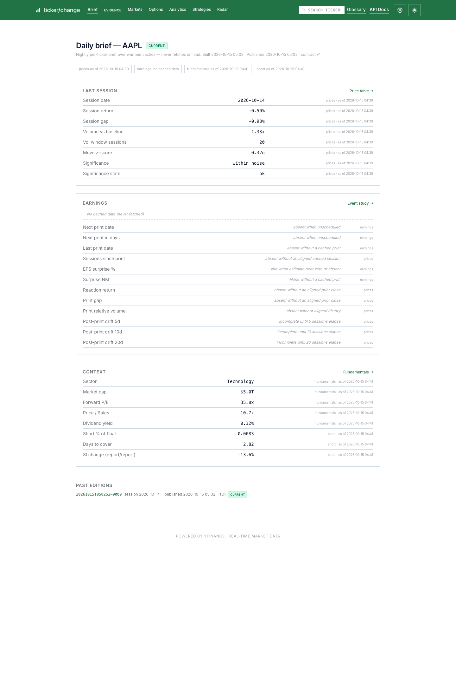

# ticker/change

> *ticker-change publishes a nightly, provenance-stamped daily brief per
> ticker — "what changed today, and does it matter?" — with a source-and-as-of
> receipt on every number, and the entire existing app demoted to drill-down
> evidence.*

**A daily brief that shows what changed, whether it matters, and the receipt
for every number it prints.**

Every number shows its source and as-of time. The brief answers one question
per ticker per session — *what changed today, and does it matter?* — and links
each claim to the deep page that proves it. Static profiles are solved by free
sites; deltas are the product.

- **Live demo:** https://ticker-change.duckdns.org



---

## What it is

| | |
| --- | --- |
| **Category** | Provenance-stamped daily brief over an equity-research drill-down app |
| **Built for** | Engineers and recruiters reading the architecture; retail traders using the briefs |
| **Data** | Free-tier sources (`yfinance`, Finnhub, FMP, SEC EDGAR) |
| **Architecture** | Single-process Flask app, SQLite cache, no frontend build step |

**Not:** a broker, a validated alpha engine, financial advice, or a replacement
for Bloomberg. The brief is deterministic — no LLM in the numbers. The optional
AI interpretation is labeled garnish and never load-bearing. See
[What we don't claim](#what-we-dont-claim).

---

## How it works

### Metric contracts

Every metric the brief can print has a contract: definition, unit, window,
source, and declared missing state. Contracts cover *all* rendered metrics —
a number cannot appear without a contract, and a gap cannot appear without a
label. Contract versions bump explicitly; labels never change silently.

### Coherent snapshot publication

Briefs are built in a nightly batch and published atomically: payload written
first, pointer moved last, retention keeps the last two editions. A failed or
invalid build never replaces the pointer, so readers see the last-good brief —
never a torn or half-built one. Page views never trigger slow fan-out fetches;
they read only what is already published (the same is true of the root
dashboard and its JSON twin).

### Tiered nightly universe

The nightly pass spends depth where it is scarce: the watchlist gets
full-depth briefs (price, earnings, context), the S&P 500 gets price and
earnings deltas, and the watchlist wins overlaps. One ticker's failure never
aborts the pass — it publishes with declared missing-states like anyone else.

### Declared missing-states

Every rendered cell is either a contract-backed value or a declared state:
`NM`, missing, stale-with-as-of, window-incomplete. A 20-session window that
isn't complete is never silently shortened; a failed source is never an
invisible blank. Session math is shared with the radar screens, so weekends
and holidays never advance "today" artificially.

### On-demand fallback

A ticker outside the nightly universe still answers: `/brief/<ticker>` builds
once on demand from cached context — with the same provenance and declared
gaps, not blanks — or renders a warming skeleton while the build runs.

### AI garnish, optional and labeled

The LLM interpretation attaches at render time, never inside the published
payload or its JSON twin. It is clearly marked AI-generated, cached, and can
be absent without the page noticing.

### Brief history

The last two editions per ticker stay navigable at stable URLs, so "what we
said yesterday" is auditable against today's brief. A read-only historical
edition serves the deterministic content alone; editions beyond retention
render a declared gone-state, never a 500.

### What everything else is

The rest of the app is drill-down evidence: deep pages keep their routes,
linked from the brief sections they substantiate.

More detail: [`CLAUDE.md`](CLAUDE.md)

---

## Quick start

```bash
python3 -m venv .venv && source .venv/bin/activate
pip install -r requirements.txt
python3 app.py
# → http://127.0.0.1:5001  (root is the universe dashboard)
```

Then open a brief: `http://127.0.0.1:5001/brief/AAPL` — or search any ticker
from the nav. Works immediately with **no configuration** — price data and SEC
EDGAR panels need no keys. The first boot warms the nightly universe in the
background; briefs render from published snapshots as each ticker lands.

Production-like:

```bash
gunicorn app:app --bind 0.0.0.0:5001 --workers 2
```

**Optional — train the ML model** (used by the analytics drill-down, not the
brief):

```bash
python ml.py train AAPL MSFT NVDA SPY ...
```

`train` reads only price history already cached in SQLite — run
`python ml.py backfill --sp500` first for S&P-wide training. Without
`model.pkl`, the ML section is omitted; predictions older than 30 days are
suppressed.

### Running tests

```bash
pip install -r requirements.txt -r requirements-test.txt
pytest tests/ -v
```

The suite runs on every push and pull request via
`.github/workflows/tests.yml`. Brief, dashboard, and snapshot tests prove a
zero-network build with sentinels on every network entry point; a few tests
shell out to `node` to parse and execute the inline navigation JavaScript in
`templates/base.html` and skip cleanly if node is absent.

---

## Drill-down evidence pages

Enter a ticker (or click a dashboard card) and the brief links into these
connected views, grouped into navigation pillars — Markets, Options,
Analytics, Strategies, Radar. The sub-navbar carries your symbol across every
page.

| View | Pillar | Route | Purpose |
| --- | --- | --- | --- |
| **Price Table** | Markets | `/stock` | Multi-period change, candlestick chart, fundamentals glance |
| **Ticker News** | Markets | `/news` | English-language headlines for the selected US or international listing |
| **Live Microstructure** | Markets | `/live` | L2 depth, trades feed, options chain + Greeks, payoff simulator |
| **S&P Heatmap** | Markets | `/heatmap` | Sector-grouped S&P 500 treemap, colored by daily % change, sized by dollar volume |
| **Options Terminal** | Options | `/options` | Dollar GEX by strike, IV term structure, 3D vol surface, Greek matrix |
| **Risk Analytics** | Analytics | `/analytics` | Volatility, VaR, GEX, Monte Carlo, **pre-trade checklist**, Buyer Signals, institutional suite |
| **Market Positioning** | Analytics | `/positioning` | Valuation, analyst ratings, insider activity, 13F holders |
| **Strategy Backtests** | Strategies | `/strategies` | Three selectable strategies, leaderboard, screener, single-ticker backtest |
| **AI Report** | Strategies | `/ai-summary` | LLM desk note synthesising metrics (optional; needs AI key) |
| **Radar** | Radar | `/radar` | Snapshot-published universe screens: earnings drift, value, squeeze |

The Options pillar also links **Options Chain** straight to `/live?tab=greeks`
— the chain is a tab of the Live view, not a route of its own.

Also: [`/glossary`](https://ticker-change.duckdns.org/glossary) (metric reference),
[`/settings`](https://ticker-change.duckdns.org/settings) (API keys),
[`/api/docs`](https://ticker-change.duckdns.org/api/docs) (OpenAPI explorer).

Every metric on these pages has an `(i)` tooltip linking to `/glossary`.
**Three display modes** — light, dark, and an Excel mode that re-renders cards
as spreadsheet-style grids with accounting-style negatives.

---

## Configuration

All keys optional; every layer degrades gracefully.

**`SETTINGS_PASSWORD`** gates the `/settings` page itself (HTTP Basic
Auth) — required, since every key saved there is global to the app
instance, not scoped per visitor. Without it, `/settings` refuses to
serve rather than falling back to open access.

Key precedence is asymmetric: Finnhub and FMP try the environment variable
first and fall back to saved settings; AI, SEC, and Marketaux prefer the saved
setting over the environment variable.

### Market data

| Env var | Provider | Powers |
| --- | --- | --- |
| _(none)_ | [SEC EDGAR](https://www.sec.gov/edgar) | Insider + 13F filings — **no key needed** |
| `FINNHUB_API_KEY` | [Finnhub](https://finnhub.io) | Fundamentals, insider, analyst data, live trades |
| `FMP_API_KEY` | [FMP](https://financialmodelingprep.com) | Institutional 13F holders |
| `MARKETAUX_API_KEY` | [Marketaux](https://www.marketaux.com) | English-language ticker news |
| `SEC_USER_AGENT` | — | Required contact string for SEC, e.g. `"Name you@email.com"` |

### AI reports *(any one provider is enough)*

| Env var | Provider |
| --- | --- |
| `ANTHROPIC_API_KEY` | Anthropic (Claude) |
| `OPENAI_API_KEY` | OpenAI |
| `GEMINI_API_KEY` | Google Gemini |
| `OPENROUTER_API_KEY` | OpenRouter |

Providers are tried in order; with none configured, the AI report and the
brief's labeled interpretation simply don't render.

---

## API

JSON twins of every view, plus health and config:

| Endpoint | Returns |
| --- | --- |
| `GET /api/brief/<ticker>` | The published daily brief payload verbatim (`warming` stub before first publish) |
| `GET /api/checklist/<ticker>` | Pre-trade checklist (`?trade_type=long_stock`) |
| `GET /api/stock/<ticker>` | Price, period changes, chart metadata |
| `GET /api/news?ticker=...` | Same-origin news feed, listing choices, freshness and availability (`?listing=` accepts a returned candidate ID) |
| `GET /api/analytics/<ticker>` | Risk stats and metrics |
| `GET /api/positioning/<ticker>` | Valuation, insider, institutional data |
| `GET /api/options-greeks/<ticker>` | Option chain + Greeks (`?expiration=`, `?strikes=N\|all`) |
| `GET /api/options-analysis/<ticker>` | IV rank, expected move, GEX, strategy posture |
| `GET /api/options-terminal/<ticker>` | Dollar GEX, term structure, vol surface, Greek matrix |
| `GET /api/options-ai-report/<ticker>` | LLM options note (needs an AI key) |
| `GET /api/institutional/<ticker>` | Microstructure, macro regime, signals backtest, 8-K events |
| `GET /api/corporate-actions/<ticker>` | Point-in-time identity and split/dividend history |
| `GET /api/raw-sec-filings/<ticker>` | Unfiltered SEC EDGAR submissions |
| `GET /api/chart-data/<ticker>` | OHLCV history |
| `GET /api/active-tickers` | Symbols currently cached (used by the cache warmer) |
| `GET /health` | `{"status": "ok"}` |

Full schema: [`/api/docs`](/api/docs)

---

## Data flow

```
  Browser ──►  Flask (dashboard, briefs, routes, charts, ML, AI)
                  │
                  ├── nightly warmers ──► SQLite (daily_prices, api_cache,
                  │                        settings, published snapshots)
                  ├── yfinance / Finnhub / FMP / SEC EDGAR (warmers fetch;
                  │   brief and dashboard read cache only, deep pages
                  │   refresh on a cache miss)
                  └── S3 (optional option-chain cache)
```

- **Caching:** 1h price freshness, 24h provider cache, 45s in-process memo;
  per-source as-of times read from the same cache-age path the receipts show
- **Option chains:** S3 first (4h TTL, survives redeploys) when
  `S3_CACHE_BUCKET` is set, then SQLite, then a live fetch, then stale reads of
  either store. With no bucket configured the S3 layer no-ops and SQLite on the
  mounted volume carries the cache on its own
- **Resilience:** stale-while-error — serves cached data when refresh fails;
  invalid builds never replace the published pointer
- **ML:** triple-barrier labels, walk-forward validation, LightGBM/sklearn

More detail: [`CLAUDE.md`](CLAUDE.md)

---

## Deploy

**Live:** https://ticker-change.duckdns.org

The live demo runs on AWS Lightsail with Nginx, HTTPS, and a persistent SQLite
database. The host deploys itself: a systemd timer runs
[`deploy/lightsail/deploy.sh`](deploy/lightsail/deploy.sh) every 5 minutes,
which builds the newest `main` commit whose Tests workflow passed and swaps the
container only once it answers `/health` (otherwise the previous container is
restored). After changing anything in `deploy/lightsail/`, reinstall it on the
host:

```bash
sudo install -m 0755 deploy.sh /usr/local/bin/ticker-change-deploy
sudo install -m 0644 ticker-change-deploy.{service,timer} /etc/systemd/system/
sudo systemctl daemon-reload && sudo systemctl enable --now ticker-change-deploy.timer
journalctl -u ticker-change-deploy   # deploy history
```

The existing Fly.io configuration remains available for that platform:

```bash
fly deploy --ha=false   # single instance — SQLite has no multi-writer story
```

Fly.io mounts a persistent volume at `/data` for `stocks.db`. Also ships with
`Dockerfile`, `Procfile`, and `render.yaml` for Render.

---

## Repo layout

Operational map for contributors and deployers — the mechanisms above live here:

```
app.py               Routes, dashboard/brief page orchestration, charts, GEX
brief.py             Brief builder: context bundle in, contract-validated dict out
brief_contracts.py   Brief metric contracts (definition, unit, window, source, missing state)
snapshot_store.py    Shared snapshot publication: payload, pointer (last), retention
radar.py             Snapshot-published universe screens (drift / value / squeeze)
radar_contracts.py   Radar row contracts
db.py                SQLite: daily_prices, api_cache, app_settings, locks
providers.py         Finnhub / FMP / SEC EDGAR / AI clients (fail gracefully)
news.py              Marketaux listing resolution, headlines, cache and quota policy

decide.py            Pre-trade checklist
signals.py           Buyer Signals factor tally
momentum_engine.py   Shared scoring + backtests for all three strategies
backtest_engine.py   Signals walk-forward simulation
event_study.py       Event-study / CAR engine
earnings.py          Session-aligned earnings event math (shared by radar + brief)

microstructure.py    VPIN, Corwin-Schultz, Amihud, squeeze risk
macro_engine.py      Macro regime, dual betas, capture ratios
derivatives_alpha.py Higher-order Greeks, variance risk premium
sec_8k.py            SEC 8-K material-event parsing and classification
corporate_actions.py Splits, dividends, point-in-time ticker identity

options/             Options terminal engine (gex, greeks, vol, cones, storage)
s3_cache.py          Optional S3 option-chain cache
warm_s3_cache.py     Cache warmer run by the hourly GitHub Action

ml.py                Offline ML training and inference
ai.py                LLM analyst reports + labeled brief interpretation
glossary.py          Metric definitions (tooltips + /glossary)
api_docs.py          OpenAPI spec behind /api/docs
warehouse.py         DuckDB warehouse experiment (not wired into the app)
templates/           Jinja2 + Tailwind CDN + ECharts / Lightweight Charts
```

---

## What we don't claim

- Market-beating alpha or validated edge (unless backtested and published in-app)
- Real-time institutional order flow or measured dealer positioning
- Financial advice or trade recommendations
- Replacement for a broker or professional risk system

GEX is modelled from open interest, not observed flow. Buyer Signals is a
descriptive heuristic tally. The brief's significance label is a deterministic
z-score against the ticker's own trailing window — arithmetic, not prophecy.
ML and AI outputs are educational tools on delayed data, and the AI
interpretation on a brief is the only generated text on it.

---

## Docs

| Doc | Contents |
| --- | --- |
| [`CLAUDE.md`](CLAUDE.md) | Architecture guide for contributors |
| [`CONTEXT.md`](CONTEXT.md) | Domain glossary and product thesis |
| [`docs/ROADMAP.md`](docs/ROADMAP.md) | Engineering roadmap and sprint plan |
| [`docs/ORCHESTRATION.md`](docs/ORCHESTRATION.md) | Planned DuckDB / dbt ELT pipeline — design notes, not built |

---

## Tech stack

Flask · yfinance · pandas · numpy · ECharts · LightGBM/sklearn · Tailwind (CDN) ·
Jinja2 · Gunicorn · AWS Lightsail

Do not commit secrets — use environment variables or `/settings`.
